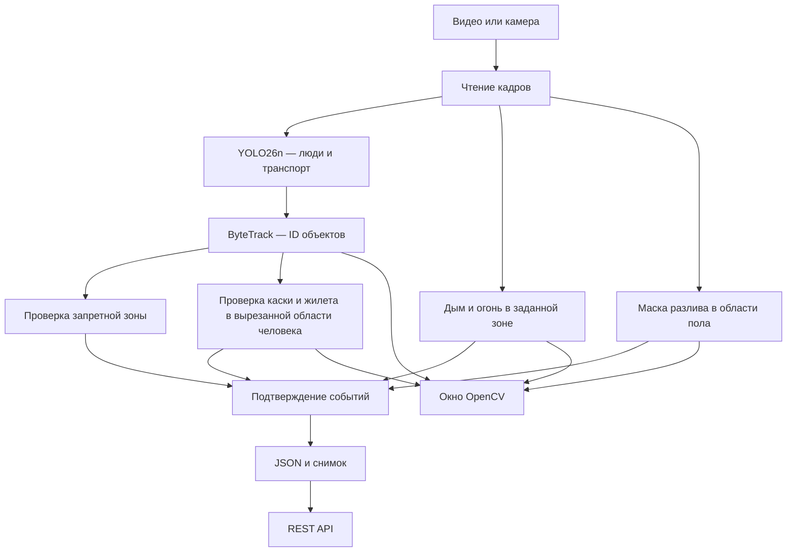

# Архитектура Industrial Vision

## Что делают модули

- `src/capture/` читает видео. При сбое камеры основной цикл записывает ошибку и повторяет подключение.
- `src/inference/` запускает модели. Общий детектор работает по полному кадру. Дым, огонь и разлив могут искать только в заданных областях.
- `src/tracking/` связывает обнаруженные объекты между кадрами и присваивает им `Track ID`.
- `src/zones/` проверяет, попадает ли середина нижней стороны рамки объекта в запретную зону. `src/ppe/` сопоставляет найденные каски и жилеты людям.
- `src/events/` подтверждает события по нескольким проверенным кадрам и ограничивает частоту повторов.
- `src/storage/` сохраняет события в JSON и записывает снимки.
- `src/api/` отдаёт состояние приложения и события. Команды изменения порогов и запретной зоны передаёт в очередь основного цикла.
- `src/monitoring/` измеряет FPS и время обработки, записывает загрузку CPU, использование памяти, температуру и место на диске.

Точка запуска — `src.main`. При текущем интервале `3` модели и трекер работают на каждом третьем кадре, а окно выводит все кадры. События подтверждаются только по кадрам с новыми результатами. Настройки находятся в [конфигурации](../configs/configuration.yaml).
