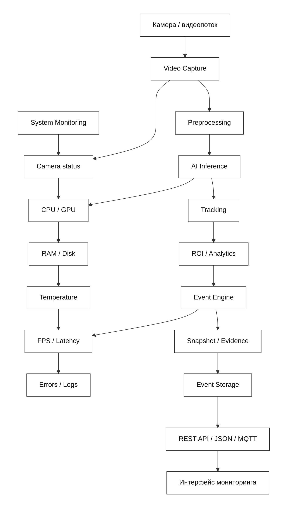

# Архитектура Industrial Vision

## Общая схема

## Описание

Система построена по модульному принципу.

Video Capture отвечает за получение кадров.
Preprocessing подготавливает изображения.
AI Inference запускает модели компьютерного зрения.
Tracking связывает объекты между кадрами.
ROI / Analytics проверяет условия аналитики.
Event Engine формирует события.
Event Storage сохраняет результаты.
REST API предоставляет доступ к событиям.

Monitoring / Logging обеспечивает контроль состояния
компонентов и регистрацию ошибок.

На первом этапе архитектура спроектирована.
Реализация модулей выполняется последовательно.
